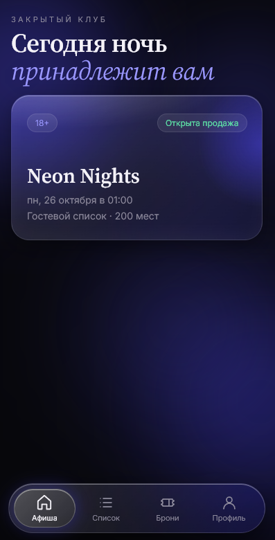
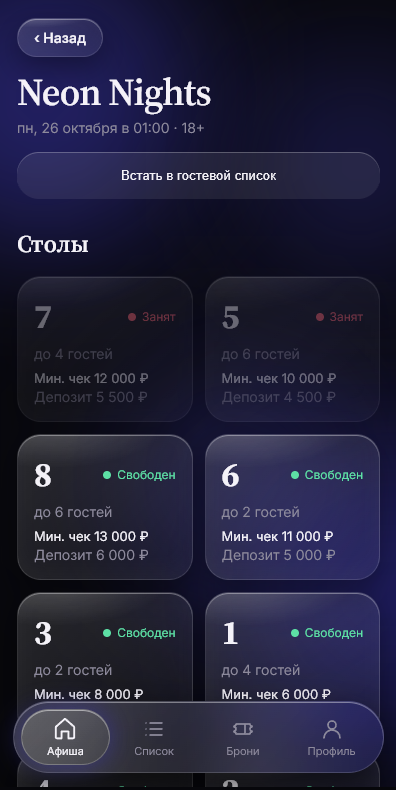
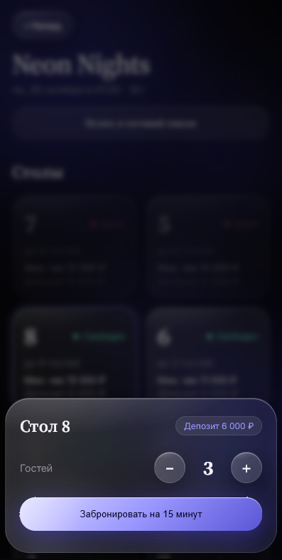
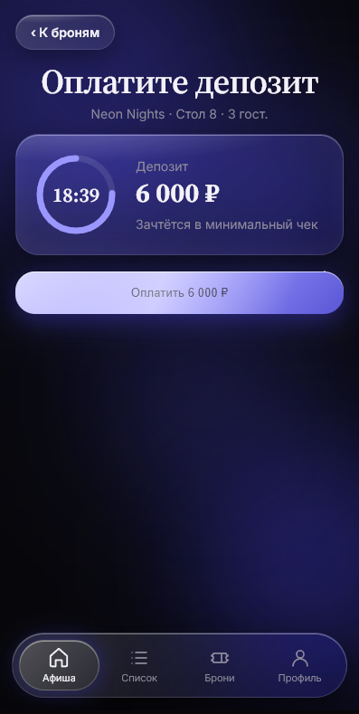
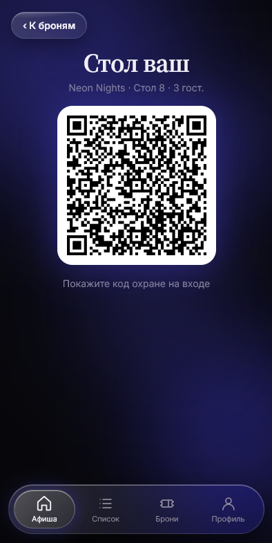
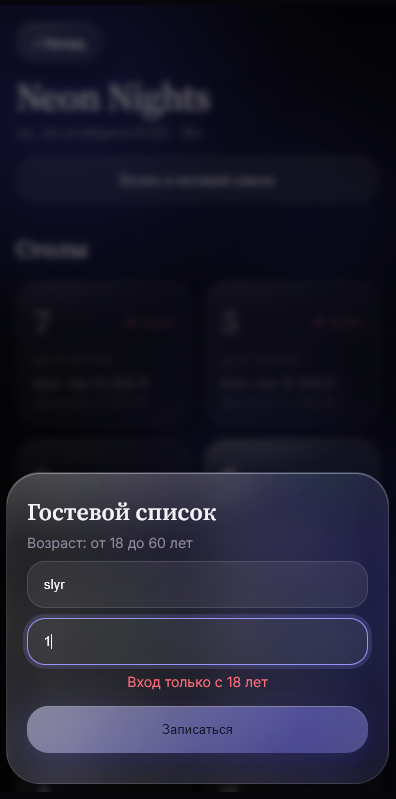
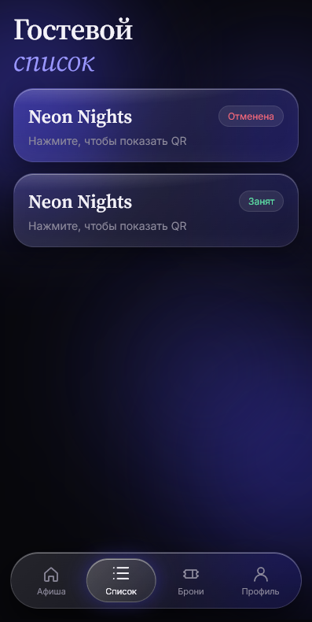
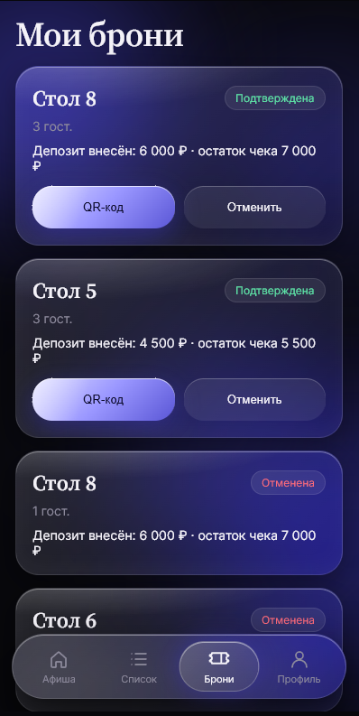
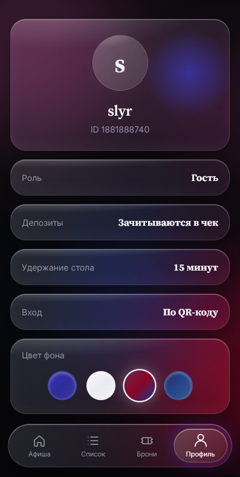

<h1 align="center">OnlyClub</h1>

<p align="center">
  
  
  
  
  
  
  
  
  
  
  
  
</p>

<h3 align="center">A private nightclub inside Telegram: tables, guest lists and QR entry</h3>

<p align="center">
  
</p>

<p align="center">🌐 <b>Language:</b> <b>English</b> · <a href="README.ru.md">Русский</a></p>

---

## 📖 Table of Contents

- [The Problem](#-the-problem)
- [The Solution](#-the-solution)
- [Real-World Business Use](#-real-world-business-use)
- [Roles (RBAC)](#-roles-rbac)
- [Core Business Rules](#-core-business-rules)
- [Screenshots](#-screenshots)
- [Architecture](#-architecture)
- [Getting Started](#-getting-started)
- [Deployment](#-deployment)
- [License](#-license)

---

## 🎯 The Problem

Running a nightclub is a logistics problem disguised as a party:

- Guests call, DM on social media or queue at the door just to ask whether a table is free.
- Managers keep guest lists in spreadsheets and chats, and every Friday something gets lost.
- Table deposits are collected inconsistently, and no-shows cost real money.
- Promoters are paid by "trust me, I brought 30 people", and commission disputes are routine.
- Door staff have no fast, reliable way to verify who is allowed in.

## ✨ The Solution

**OnlyClub** moves the whole night into Telegram, where guests already are. No app to install, no account to create: authorization comes from Telegram itself.

From choosing a table to walking through the door with a QR code, every step is automated, tracked and protected, and the club gets clean data and automatic commission payouts as a side effect.

---

## 💼 Real-World Business Use

OnlyClub is built around how a real club earns and loses money.

| Business pain | How OnlyClub handles it |
|---|---|
| **Empty tables / lost bookings** | Guests see live table availability and book in a few taps, any time of day, with no phone call to a manager. |
| **No-shows** | A deposit is required to confirm a table. If the guest doesn't show up, the deposit stays with the club. |
| **Table double-booking** | Bookings run inside database transactions (Unit of Work), so two guests can never hold the same table. |
| **Unpaid reservations blocking tables** | A table is held for 15 minutes. If the deposit isn't paid, it is released back to the floor automatically. |
| **Late cancellations** | A tiered refund policy discourages last-minute cancellations while staying fair to early ones. |
| **Underage entry / legal risk** | Age is validated (18–60) when joining the guest list, and security verifies it again at the door. |
| **Overcrowding** | Guest lists have hard capacity limits per event. |
| **Promoter disputes** | Every guest is attributed to a promoter through a personal link, and commissions are calculated by the system when the event is closed. |
| **Slow, chaotic entrance** | Security scans a QR code and checks the guest in within seconds, whether they hold a table booking or a guest-list spot. |
| **Manual accounting** | Managers close an event and trigger the commission calculation and payout flow in one action. |

**Who it's for:** private clubs, lounges, event venues and any business with limited seating, a door policy and a promoter network.

**How it makes money for the venue:**
- Higher table occupancy through frictionless self-service booking.
- Protected revenue through deposits that are credited toward the minimum check and kept on no-shows.
- A scalable promoter channel with transparent, automated payouts.
- Less staff time spent on calls, chats and manual lists.

---

## 👥 Roles (RBAC)

A strict role-based access model is enforced on the backend.

| Role | What they can do |
|---|---|
| **Guest** | Browse the event feed, book tables with a deposit, join the guest list, receive personal QR codes for entry. |
| **Security** | Scan QR codes at the entrance, verify age, mark a guest as seated at a table or passed through the list (Check-In). |
| **Promoter** | Has a personal referral link, sees the list of their guests, and tracks accumulated commission. |
| **Manager** | Creates events and tables, closes events, triggers automatic commission calculation and manages payouts. |

---

## ⚖️ Core Business Rules

### 🔐 Security & authorization
- Authorization is done by validating the Telegram **HMAC-SHA256** signature of the Mini App init data.
- Tokens are time-limited (**24 hours**), so user data cannot be forged or replayed indefinitely.
- Custom TMA `AuthenticationHandler` plugs directly into the ASP.NET Core auth pipeline.

### 🪑 Smart table bookings
- A table is **held for 15 minutes** while the guest pays the deposit.
- The deposit is **credited toward the minimum check**.
- **No-show:** the deposit stays with the club.
- **Refund on cancellation:**

| Time before the event | Refund |
|---|---|
| More than 48 hours | **100%** |
| 12 to 48 hours | **50%** |
| Less than 12 hours | **0%** |

### 📝 Guest list
- Age is strictly controlled: **18 to 60 years**.
- Capacity limits are enforced per event.
- A guest can add up to **3 companions**.

### 📣 Promoter system
- A guest who arrives via a promoter's link is **attributed to that promoter for 72 hours** before the event starts.
- When the event is closed, the promoter's commission is calculated automatically from:
  - a **fixed fee per guest**,
  - **volume bonuses**,
  - a **percentage of deposits** from attributed bookings.

---

## 📱 Screenshots

| Event feed | Table selection | Booking sheet |
|:---:|:---:|:---:|
|  |  |  |

| Deposit & 15-min timer | QR entry pass | Guest list form |
|:---:|:---:|:---:|
|  |  |  |

| My guest list | My bookings | Profile & themes |
|:---:|:---:|:---:|
|  |  |  |

---

## 🏗 Architecture

The solution follows Clean Architecture, with dependencies pointing inward toward the domain.

```
OnlyClub.sln
├── OnlyClub.Core            Domain entities, enums, business rules
├── OnlyClub.Application     Use cases, services, interfaces (ports)
├── OnlyClub.Adapters        Implementations of application ports
├── OnlyClub.Infrastructure  EF Core, PostgreSQL, repositories, Unit of Work
└── OnlyClub                 Minimal API host, auth handler, exception handler, DI
```

### Technical highlights

- Glassmorphism UI built with vanilla CSS and **4 switchable themes** driven by CSS variables.
- Bottom sheets rendered through React `createPortal`, so they always appear above the interface.
- Custom Telegram Mini App `AuthenticationHandler` and a global `IExceptionHandler` returning standardized JSON errors.
- Transactions via the **Unit of Work** pattern to prevent double-booking of tables.
- Fully containerized with Docker and deployed on Render.

---

## 🚀 Getting Started

### Prerequisites

- [.NET 8 SDK](https://dotnet.microsoft.com/download/dotnet/8.0)
- [Node.js 18+](https://nodejs.org/)
- [Docker](https://www.docker.com/) (recommended)
- A Telegram bot created via [@BotFather](https://t.me/BotFather)

### Run with Docker

```bash
git clone https://github.com/slayr444/OnlyClub.git
cd OnlyClub
docker compose up --build
```

### Run locally

```bash
dotnet restore
dotnet run --project OnlyClub
```

For the frontend:

```bash
cd frontend
npm install
npm run dev
```

### Configuration

Set the following values through environment variables or `appsettings`:

| Key | Description |
|---|---|
| `ConnectionStrings__Default` | PostgreSQL connection string |
| `Telegram__BotToken` | Bot token from @BotFather, used to validate the init-data signature |

Telegram Mini Apps require HTTPS. For local development, expose your dev server through a tunnel (for example ngrok or Cloudflare Tunnel) and set the resulting URL as the Mini App URL in @BotFather.

---

## ☁️ Deployment

The project ships with a `Dockerfile` and `docker-compose.yml` and is deployed on [Render](https://render.com/). Provision a PostgreSQL instance, set the environment variables above on the web service, and point your bot's Mini App URL to the deployed HTTPS address.

---

## 📄 License

No license yet.

---

<div align="center">

Made with ☕ and neon by [slayr444](https://github.com/slayr444)

</div>